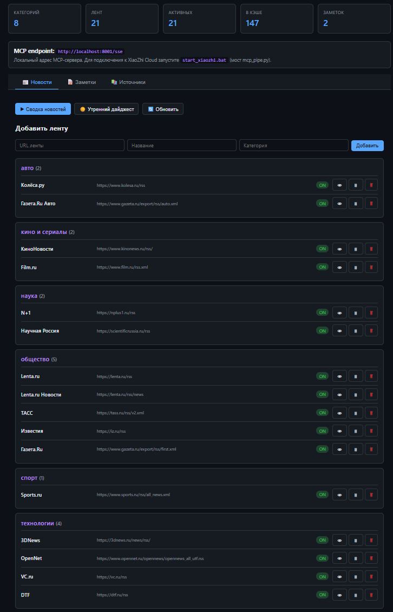
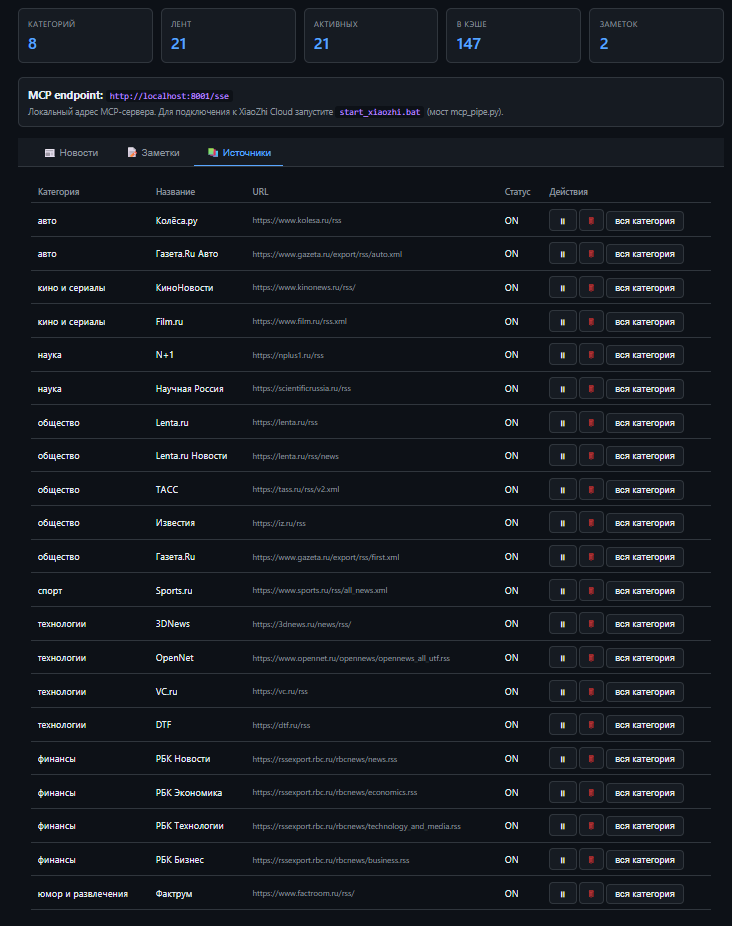
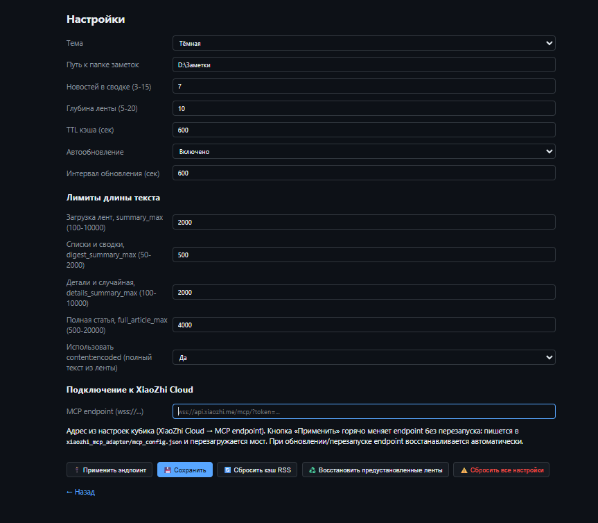
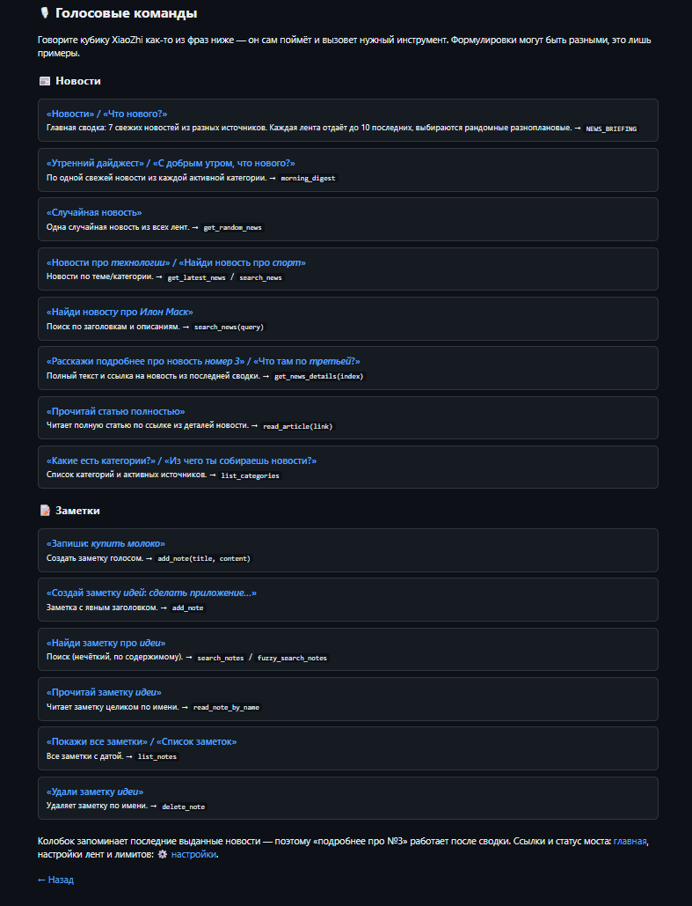

# 📰 XiaoZhi News Manager

[](https://github.com/Glamych/xiaozhi-news-manager/actions/workflows/ci.yml)


**Твой персональный новостной редактор и менеджер заметок с голосовым управлением.**
Превращает умный кубик [XiaoZhi](https://github.com/78/xiaozhi) (ESP32) в «умную колонку», которая по команде рассказывает свежие новости, ищет по твоим заметкам и записывает новые — обычным человеческим языком, через протокол MCP.

## ✨ Что умеет

- 🗞 **Сводка новостей по голосу** — «Новости!» → 7 свежих новостей из разных категорий. Каждая лента отдаёт до 10 последних, источники и порядок случайные — сводки не повторяются.
- 🌅 **Утренний дайджест** — «Доброе утро, что нового?» — по одной свежей новости из каждой активной категории.
- 🎲 **Любая новость и поиск** — «Новости про технологии», «Найди новость про ИИ», «Подробнее про третью» — кубик сам выберет, при необходимости раскроет полную статью по ссылке.
- 📝 **Заметки голосом** — «Запиши купить молоко завтра», «Найди заметку про идеи», «Прочитай заметку рецепты», «Удали заметку покупки». Каждая заметка — отдельный `.md` в любой папке, кириллица в путях работает.
- 🎙 **Мануал команд в приложении** — страница `/commands` с готовыми фразами и разбором, что за инструмент они вызывают.
- 🌐 **Веб-интерфейс** — дашборд со статистикой (категории/ленты/кэш), управление лентами по категориям с вкл/выкл, добавление своих RSS.
- 🔧 **Гибкие лимиты текста** — настрой длину сводок, деталей и полных статей прямо в UI: кубик не будет читать «простыню».
- 🔌 **Горячая замена endpoint** — вставь новый MCP endpoint из XiaoZhi Cloud в настройках — мост переподключится без перезапуска приложения.
- 🪟 **Настоящее трей-приложение** — один фоновый процесс `pythonw` без чёрного окна, автозапуск с Windows, иконка в трее, окно быстрой заметки.

## 📸 Скриншоты

### 📊 Дашборд — новости, ленты и статистика


### 🗂 Источники — живые RSS-ленты по категориям


### ⚙️ Настройки — лимиты текста и подключение к XiaoZhi Cloud


### 🎙 Голосовые команды — готовые фразы для кубика


---

## 📦 Структура проекта

```
xiaozhi-news-manager/
├── app.py                  # Всё приложение в одном файле
├── requirements.txt        # Зависимости
├── Dockerfile              # Образ для контейнера
├── docker-compose.yml      # Сервисы и тома
├── start.bat               # Локальный запуск (pythonw)
├── stop.bat                # Остановка процесса
├── install_autostart.bat   # Автозапуск в Windows
├── uninstall_autostart.bat # Удаление автозапуска
├── start_xiaozhi.bat       # (устар.) простой мост mcp_pipe.py — рекомендуется адаптер
├── mcp_pipe.py             # (устар.) официальный мост XiaoZhi
├── mcp_config.json         # (устар.) конфиг моста: http://localhost:8001/sse
├── .gitignore              # не коммитит config.json (токен), логи, заметки
├── .dockerignore
├── config.example.json     # шаблон конфига (без токена)
├── README.md               # этот мануал
└── (создаётся автоматически при первом запуске)
    ├── config.json         # Настройки (в т.ч. xiaozhi_endpoint с токеном — не коммитить)
    ├── feeds.json          # RSS-ленты (живые, проверенные)
    ├── notes/              # Каждая заметка = отдельный .md
    ├── static/icon.png     # Иконка трея
    └── app.log              # Логи

Мост к XiaoZhi Cloud — отдельный проект [xiaozhi_mcp_adapter](https://github.com/Hoshino-Kumo/xiaozhi_mcp_adapter)
(порт 8765), ставится рядом: `../xiaozhi_mcp_adapter`.
```

---

## 🚀 Установка и запуск

### 1. Локально на Windows

> Нужен **Python 3.10+** с [python.org](https://python.org). При установке отметьте **«Add Python to PATH»**.

```bat
:: Один раз — поставить зависимости
pip install -r requirements.txt

:: Запустить (двойной клик или из консоли)
start.bat
```

Либо вручную:

```bat
pythonw app.py
```

`pythonw` запускает приложение **без чёрного окна консоли** — только иконка в системном трее. Браузер при запуске **не открывается** — кликните по иконке трея левой кнопкой.

### 2. Docker

```bash
docker-compose up -d
```

В контейнере нет GUI, поэтому трей отключён (флаг `--no-tray` + `ENV DOCKER=true`). Запускаются только Flask и MCP.

- Веб: http://localhost:5000
- MCP: http://localhost:8001/sse

Остановка:

```bash
docker-compose down
```

Тома `./data` (feeds.json, config.json) и `./notes` (заметки) сохраняются между перезапусками.

### 3. Автозапуск в Windows

Способ 1 — `install_autostart.bat` (ярлык в `shell:startup`, `WindowStyle=Minimized`), удаление: `uninstall_autostart.bat`.

Способ 2 (используется вручную) — VBS-файлы в папке `shell:startup`, скрывают консоль и пишут лог рядом:

| Файл | Что запускает | Лог |
|---|---|---|
| `XiaozhiNews.vbs` | `app.py` (порт 5000 + SSE 8001) | `xiaozhi_news.log` |
| `XiaozhiAdapter.vbs` | `xiaozhi_mcp_adapter\app.py` (порт 8765, wss-мост) | `adapter.log` |

Положите VBS в `%APPDATA%\Microsoft\Windows\Start Menu\Programs\Startup` — оба сервиса поднимутся при входе в систему.

### 4. Подключение к Astra Cloud / Astra Console

В Astra Console создайте новый MCP-сервер с URL:

```
http://localhost:8001/sse
```

Для доступа снаружи (например, чтобы куб XiaoZhi в другой сети мог дотянуться) используйте ngrok:

```bash
ngrok http 8001
# Получите URL вида https://xxxx.ngrok-free.app/sse
```

Подставьте его в Astra Cloud → MCP-серверы.

### 5. Подключение к XiaoZhi (xiaozhi.me) — ОФИЦИАЛЬНАЯ ИНТЕГРАЦИЯ

> **Важно:** XiaoZhi работает по другой схеме, чем Astra Cloud. Куб XiaoZhi НЕ подключается к нашему MCP-серверу напрямую. Вместо этого локальный **адаптер-мост** ([xiaozhi_mcp_adapter](https://github.com/Hoshino-Kumo/xiaozhi_mcp_adapter), порт **8765**) подключается к **MCP endpoint** на xiaozhi.me и связывает XiaoZhi Cloud с нашим sse-сервером (порт **8001**). Эндпоинт меняется **горячо** прямо из веб-интерфейса (`/settings`).

#### Архитектура

```
[Куб XiaoZhi (ESP32)]
        ↓ голос
[XiaoZhi Cloud]
        ↓ WebSocket (wss://api.xiaozhi.me/mcp/?token=…)
[xiaozhi_mcp_adapter — мост, порт 8765]   ← запускается на вашей машине
        ↓ http://localhost:8001/sse  (mcp_proxy)
[Наш app.py — FastMCP(sse), порт 8001]
        ↓
[14 MCP-инструментов: NEWS_BRIEFING, search_notes, add_note, …]
```

#### Пошаговая настройка

**Шаг 1.** Запустите приложение (`start.bat`) — на `http://localhost:8001/sse` должен отвечать MCP-сервер, на `http://localhost:5000` — веб-интерфейс.

**Шаг 2.** Зайдите на **xiaozhi.me** → логин → раздел «智能体 / Агенты» → выберите вашего агента → в правом нижнем углу будет ваш персональный **MCP endpoint** вида:

```
wss://api.xiaozhi.me/mcp/?token=…
```

Скопируйте его.

**Шаг 3 (горячо, из UI).** Откройте `http://localhost:5000/settings` → «Подключение к XiaoZhi Cloud» → вставьте endpoint в поле → кнопка **«🔌 Применить эндпоинт»**. Он прописывается в конфиг адаптера и мост перезагружается **без перезапуска**. Статус моста (`connected`) показывается рядом. Endpoint сохраняется в `config.json` и **восстанавливается автоматически** при старте/обновлении.

**Шаг 4.** Запустите мост: `xiaozhi_mcp_adapter\start_adapter.bat` (или включите автозапуск — см. выше). Адаптер подключится к XiaoZhi Cloud.

**Шаг 5.** Скажите кубу: «Новости» — XiaoZhi Cloud вызовет `NEWS_BRIEFING` через мост, и вы услышите сводку (каждый раз рандомные из последних ~10 новостей каждой ленты).

#### Конфиг `mcp_config.json`

`mcp_pipe.py` читает этот файл, чтобы знать, какой локальный MCP-сервер связать с XiaoZhi Cloud. У вас уже есть готовый:

```json
{
  "mcpServers": {
    "xiaozhi-news": {
      "type": "sse",
      "url": "http://localhost:8001/sse",
      "disabled": false
    }
  }
}
```

Можно добавить сюда и другие локальные MCP-серверы — все они будут видны XiaoZhi.

#### Если что-то не работает

| Симптом | Решение |
|---|---|
| `mcp_pipe.py` не скачивается | Скачайте вручную с https://raw.githubusercontent.com/78/mcp-calculator/main/mcp_pipe.py и положите рядом с `start_xiaozhi.bat` |
| Мост падает с ошибкой `401` / `connection refused` | Проверьте `MCP_ENDPOINT` — он должен быть полным `wss://...`. Перегенерируйте его на xiaozhi.me если истёк |
| XiaoZhi не вызывает инструменты | Убедитесь что на странице агента на xiaozhi.me **включён** MCP (есть галочка/переключатель) |
| Мост не видит sse-сервер | Проверьте в браузере http://localhost:8001/sse — должен возвращать поток событий (а не ошибку) |
| Адаптер не стартует / порт 8765 закрыт | Убедитесь, что приложение (8001) запущено; посмотрите `xiaozhi_mcp_adapter\adapter.log`. Если `mcp_proxy` падает — в `.venv` адаптера нужен `mcp<2` (`pip install "mcp<2"`) |
| Все инструменты есть, но XiaoZhi молчит | На xiaozhi.me в настройках агента убедитесь, что в «системном промпте» упомянуты ваши инструменты, или просто скажите: «Какие у тебя есть MCP-инструменты?» |

#### Ручной запуск (без .bat)

```bash
# Установить зависимости
pip install websockets python-dotenv mcp-proxy

# Скачать mcp_pipe.py
curl -O https://raw.githubusercontent.com/78/mcp-calculator/main/mcp_pipe.py

# Задать endpoint
set MCP_ENDPOINT=wss://api.xiaozhi.me/mcp/XXXX  # Windows
export MCP_ENDPOINT=wss://api.xiaozhi.me/mcp/XXXX  # Linux/Mac

# Запустить мост
python mcp_pipe.py
```

> **Разница с Astra Cloud:** для Astra вы вставляете URL MCP-сервера в их консоль (и нужен ngrok для внешнего доступа). Для XiaoZhi вы запускаете локальный мост, который сам подключается к их облаку — **ngrok не нужен**, трафик идёт изнутри наружу через WebSocket.

---

## 🖱️ Управление через трей

| Пункт меню | Действие |
|---|---|
| ➕ **Новая заметка** | Открывает окно tkinter (Заголовок + Текст) |
| ⚡ **Молниеносная заметка** | Однострочный ввод (заголовок = первые 50 символов) |
| 📰 **Открыть интерфейс** | Открывает http://localhost:5000 в браузере |
| 🔄 **Обновить новости** | Принудительный рефреш всех лент |
| 📝 **Последние заметки** | Подменю с 5 последними заметками (клик → браузер) |
| ⏸️ **Пауза** / ▶️ **Продолжить** | Пауза автообновления RSS |
| 🔧 **Настройки** | http://localhost:5000/settings |
| ℹ️ **Статистика** | Уведомление со статистикой |
| 🌐 **Копировать MCP URL** | Буфер обмена + уведомление |
| ❌ **Выход** | Корректная остановка всего |

**Левый клик** по иконке — открыть веб-интерфейс в браузере.

**Tooltip** обновляется каждые 30 секунд: `XiaoZhi News — N кат, N лент, N нов, N зам`.

---

## 📝 Заметки

Каждая заметка — **отдельный `.md` файл** в папке `notes/`. Это нужно чтобы:
- AI мог искать по всем файлам и находить нужную
- Можно прочитать конкретную заметку целиком
- Удалять по одной

**Формат файла:**

```markdown
# Заголовок

*Создана: 15.01.2025 14:30*
*Источник: трей / веб / голос*

Текст заметки...
```

**Логика сохранения (окно tkinter):**
- Имя файла = заголовок (русские буквы допустимы в файловой системе)
- Если файл существует — к имени добавляется timestamp (`_20250115_143000`)
- Tray-уведомление: «✅ Заметка сохранена: {заголовок}»
- Окно закрывается

---

## ⚙️ Конфигурация (`config.json`)

> `config.json` в репозиторий не коммитится (в нём токен endpoint). Скопируйте `config.example.json` → `config.json` и заполните, либо просто запустите приложение — оно создаст дефолтный конфиг само.

```json
{
  "notes_dir": "notes",
  "theme": "dark",
  "feeds_file": "feeds.json",
  "web_port": 5000,
  "mcp_port": 8001,
  "cache_ttl": 600,
  "news_depth": 10,
  "news_count": 7,
  "auto_refresh": true,
  "refresh_interval": 600,
  "summary_max": 800,
  "digest_summary_max": 300,
  "details_summary_max": 800,
  "full_article_max": 4000,
  "use_full_content": true,
  "xiaozhi_endpoint": "wss://api.xiaozhi.me/mcp/?token=YOUR_TOKEN_HERE",
  "adapter_dir": "../xiaozhi_mcp_adapter"
}
```

`notes_dir` — относительный путь (создаётся рядом с `app.py`) или абсолютный (укажите свой, кириллица поддерживается).

### Лимиты длины текста

| Параметр | Дефолт | Где применяется |
|---|---|---|
| `summary_max` | 800 | Обрезка описания при загрузке ленты (кэш) |
| `digest_summary_max` | 300 | Списки в сводке, утреннем дайджесте, поиске |
| `details_summary_max` | 800 | `get_news_details`, `get_random_news` |
| `full_article_max` | 4000 | `read_article` (скачивание HTML-страницы) |
| `use_full_content` | true | Брать полный текст из `<content:encoded>`, если лента отдаёт |

Рекомендации: для голосового ассистента удобно `summary_max=2000`, `digest_summary_max=500`, `details_summary_max=2000`. Все параметры редактируются в `/settings` → «Лимиты длины текста»; после сохранения сбросьте кэш RSS, чтобы ленты перечитались.

> **Важно:** большинство RSS-лент (Lenta.ru, ТАСС, РБК, Коммерсантъ) в `<description>` отдают только короткий анонс 100–300 символов — это дизайн RSS, не урезка приложения. Для полного текста используйте `read_article(link)`; в `get_news_details` при коротком описании (<200 символов) полная статья докачивается автоматически.

---

## 📰 Предустановленные RSS-ленты

Живые проверенные ленты (все остальные в старом списке отдавали 404/HTML и удалены):

| Категория | Ленты |
|---|---|
| **технологии** | 3DNews, OpenNet, VC.ru, DTF |
| **кино и сериалы** | КиноНовости, Film.ru |
| **спорт** | Sports.ru |
| **наука** | N+1, Научная Россия |
| **финансы** | РБК Новости, РБК Экономика, РБК Технологии, РБК Бизнес |
| **авто** | Колёса.ру, Газета.Ru Авто |
| **общество** | Lenta.ru, Lenta.ru Новости, ТАСС, Известия, Газета.Ru |
| **юмор и развлечения** | Фактрум |

В `/settings` → кнопка «♻️ Восстановить предустановленные ленты» сбрасывает `feeds.json` к этому списку.

---

## 🔌 MCP-инструменты

Регистрируются через `@mcp.tool()`. Полный список:

### НОВОСТИ

| Инструмент | Описание |
|---|---|
| `get_random_news(category="")` | Случайная новость. Заголовок + описание до 300 симв + источник |
| `get_latest_news(category="", limit=5)` | Последние заголовки по номерам |
| `NEWS_BRIEFING()` | **ГЛАВНЫЙ для команды «новости»**. Сводка из 7 новостей из разных источников |
| `search_news(query)` | Поиск по заголовкам и описаниям (до 5 результатов) |
| `morning_digest()` | По одной свежей новости из каждой активной категории (до 12) |
| `get_news_details(index, category="")` | Подробности по номеру из последней сводки |
| `list_categories()` | Список категорий + активные источники |
| `read_article(link)` | Прочитать статью по URL (до 2000 символов) |

### ЗАМЕТКИ

| Инструмент | Описание |
|---|---|
| `search_notes(query)` | Поиск по всем `.md` (релевантность: имя +50, заголовок +40, слово в тексте +5, фраза +30) |
| `read_note_by_name(filename)` | Прочитать заметку целиком (частичное совпадение имени) |
| `list_notes()` | Все заметки с датой и размером |
| `add_note(title, content)` | Создать заметку (AI может голосом: «запиши что…») |
| `delete_note(filename)` | Удалить заметку |
| `fuzzy_search_notes(query, threshold=60)` | Нечёткий поиск (rapidfuzz, fallback на обычный) |

---

## 🌐 Веб-интерфейс (Flask)

### Страницы

- `/` — главная (вкладки: **📰 Новости** / **📝 Заметки** / **📚 Источники**)
- `/settings` — настройки (в т.ч. **горячая замена MCP endpoint** и лимиты длины текста)
- `/commands` — **🎙 мануал голосовых команд** (все инструменты + примеры фраз)
- `/note/<name>` — просмотр конкретной заметки

В шапке каждой страницы — кнопки **«🎙 Команды»** и **«⚙️ Настройки»**.

### Главная страница

1. Вкладки: Новости / Заметки / Источники
2. Заголовок + кнопки «🎙 Команды» / «⚙️ Настройки» + тема (🌙/☀️) + «➕ Заметка»
3. Панель статистики: категорий, лент, активных, кэш, заметок
4. Инфоблок: локальный MCP endpoint URL (порт 8001); для XiaoZhi Cloud используется адаптер-мост (8765)
5. Вкладка **Новости**: кнопки «▶ Сводка», «☀️ Утренний дайджест», форма добавления ленты, карточки категорий с кнопками 👁/⏸▶/🗑
6. Вкладка **Заметки**: список, поиск, кнопки ➕/📁, клик → просмотр, ✏️ редактировать, 🗑 удалить
7. Вкладка **Источники**: таблица всех лент, массовое вкл/выкл по категории

### Настройки (`/settings`)

- Тема (тёмная/светлая)
- Путь к папке заметок (поддерживает кириллицу, напр. `D:\Заметки`)
- Количество новостей в сводке (3-15)
- Глубина ленты (5-20)
- TTL кэша (сек)
- Автообновление (вкл/выкл) + интервал
- **Лимиты длины текста**: `summary_max`, `digest_summary_max`, `details_summary_max`, `full_article_max`, `use_full_content`
- **Подключение к XiaoZhi Cloud**: поле MCP endpoint + кнопка **«🔌 Применить эндпоинт»** (горячая замена, статус моста)
- Кнопки: «Сбросить кэш RSS», «Восстановить предустановленные ленты», «Сбросить все настройки»

### Голосовые команды (`/commands`)

Страница-мануал всех голосовых команд, сгруппированных по **Новости** и **Заметки**, с примерами фраз («Новости», «Утренний дайджест», «Расскажи подробнее про №3», «Запиши…», «Найди заметку…») и соответствующими MCP-инструментами.

### Темы

CSS через переменные (`--bg`, `--card`, `--border`, `--text`, `--muted`, `--accent`, `--success`, `--error`), переключатель `body.light`, `transition: 0.3s`.

| | Тёмная (default) | Светлая |
|---|---|---|
| bg | `#0d1117` | `#f6f8fa` |
| card | `#161b22` | `#ffffff` |
| accent | `#58a6ff` | `#0969da` |
| accent2 | `#bc8cff` | `#8250df` |

---

## 🎙️ Голосовые команды для XiaoZhi

Полный интерактивный мануал — прямо в приложении: **http://localhost:5000/commands** (кнопка «🎙 Команды» в шапке). Таблица-шпаргалка:

| Что сказать | → Инструмент MCP |
|---|---|
| **«Новости»** | `NEWS_BRIEFING()` — сводка: рандомные 7 новостей из последних ~10 каждой ленты |
| **«Расскажи случайную новость»** | `get_random_news()` |
| **«Новости о технологиях»** | `get_random_news("технологии")` |
| **«Поищи новости про ИИ»** | `search_news("ИИ")` |
| **«Доброе утро»** | `morning_digest()` |
| **«Подробнее про третью»** | `get_news_details(3)` |
| **«Найди в заметках пароль от вайфай»** | `search_notes("пароль вайфай")` |
| **«Запиши: купить молоко завтра»** | `add_note("Купить молоко", "завтра")` |
| **«Какие у меня заметки?»** | `list_notes()` |
| **«Прочитай заметку рецепты»** | `read_note_by_name("рецепты")` |
| **«Удали заметку про покупки»** | `delete_note("покупки")` |

---

## 🧠 Архитектура

```
┌─────────────────────────────────────────────────────────────┐
│                    Один процесс pythonw                       │
│                                                               │
│  Основной поток                                                │
│    └─ pystray (иконка в трее, контекстное меню)                │
│                                                               │
│  Daemon-потоки                                                │
│    ├─ Flask (5000) — веб-интерфейс + REST API                 │
│    ├─ FastMCP (8001, sse) — для Astra Cloud / XiaoZhi         │
│    ├─ RSS auto-refresh (по refresh_interval сек)              │
│    └─ Первичная загрузка лент (один раз при старте)            │
│                                                               │
│  По запросу (из трея/веба)                                     │
│    └─ Tkinter-окно заметки (отдельный поток)                 │
└─────────────────────────────────────────────────────────────┘
                            │
        ┌───────────────────┼───────────────────┐
        ▼                   ▼                   ▼
   notes/*.md         feeds.json           cache (in-memory)
   (файлы)            (файл)              {(cat,url): items}
```

**Флаги командной строки:**
- `--no-tray` / `--headless` — без трея (Flask в основном потоке, блокирующий)
- `--port N` — override `web_port`
- `ENV DOCKER=true` — то же, что `--no-tray`, файлы конфигов в `/app/data`

**Обработка ошибок:**
- `try/except` во всех потенциально-опасных местах — приложение не должно падать
- Логи в `app.log` рядом с `app.py`: `[дата время] уровень сообщение`
- При `pythonw` все логи идут только в файл (нет stdout/stderr)

---

## 🔍 Поиск заметок — алгоритм релевантности

| Совпадение | Баллы |
|---|---|
| В имени файла | +50 |
| В первой строке (заголовок) | +40 |
| Полная фраза в тексте | +30 |
| Каждое слово в тексте | +5 (макс +20) |

До 10 результатов, для каждого — фрагмент вокруг совпадения (до 300 символов).

Для нечёткого поиска (опечатки) — `fuzzy_search_notes` через `rapidfuzz` (если установлен, иначе fallback на обычный поиск).

---

## 📊 Сбор новостей

```
collect_news(category="") -> list
  · из всех активных лент указанной категории (или всех)
  · из каждой ленты до news_depth записей (по умолчанию 10)
  · каждая запись: title, summary, link, date, source, source_url, category

build_news_digest(count=7, category="") -> str
  · interleaving: чередование источников (не более 2 подряд из одного)
  · формат: «1. Заголовок — описание до 150 симв — Источник»
  · в конце: «Всего N новостей из M источников»
```

`NewsMemory` хранит последние выданные новости (при вызове `NEWS_BRIEFING` или `get_latest_news`). `get_news_details(index)` обращается к этому списку (1-based). Если список пуст — «Сначала запросите новости».

---

## 🛠️ Отладка

**Не запускается?**

```bat
:: Проверить Python
python --version
pythonw --version

:: Установить зависимости
pip install -r requirements.txt

:: Запустить с логами в консоли (для отладки)
python app.py --no-tray

:: Логи
type app.log
```

**Трей не появляется на Windows:**
- Проверьте, что `pystray` и `Pillow` установлены
- Проверьте `app.log` рядом с `app.py`

**MCP не отвечает:**
- Проверьте порт 8001: `netstat -an | findstr :8001`
- Проверьте, что в `requirements.txt` есть `mcp>=1.0.0`
- Логи в `app.log`

**Хочу сменить папку заметок:**
- `/settings` → «Путь к папке заметок» → Save
- Или отредактируйте `config.json` напрямую и перезапустите

---

## 📋 Лицензия

Свободно для личного использования. RSS-ленты принадлежат их источникам.

---

**Сделано для XiaoZhi — голосового AI-ассистента на ESP32.**
